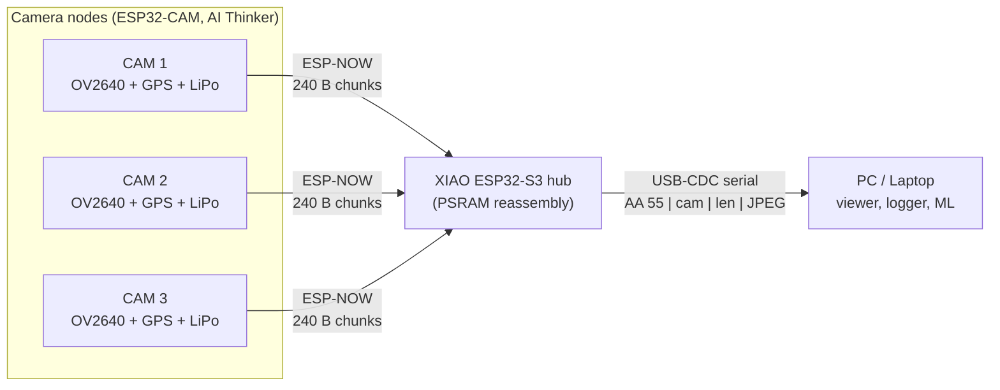
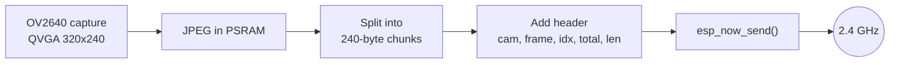
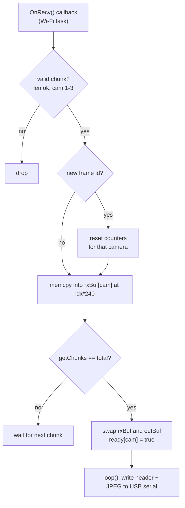

# SkyLink: Multi-Camera Wireless Image Streaming over ESP-NOW
### ESP32-CAM nodes → XIAO ESP32-S3 hub → PC
# ESP-NOW Multi-Camera Wireless Photo Link (ESP32-CAM → XIAO ESP32-S3)

A **router-free, long-lived wireless imaging link**: up to **3 ESP32-CAM nodes** capture JPEG frames and stream them over **ESP-NOW** (peer-to-peer 2.4 GHz, no Wi-Fi AP, no internet) to a single **Seeed XIAO ESP32-S3** hub. The hub reassembles the chunked JPEGs in PSRAM and forwards them to a PC over **USB-CDC serial** using a tiny framed protocol.

Each camera node is also fitted with a **GPS module** and runs from a **single-cell LiPo**, which makes it suitable for field / remote / aerial-style experiments (the sample frames in this repo were captured outdoors, looking at the sky).

<p align="center">
  
  
  
</p>

---

## Table of contents
1. [Features](#features)
2. [System architecture](#system-architecture)
3. [Hardware](#hardware)
4. [Wiring and connections](#wiring-and-connections)
5. [Wireless protocol (chunking)](#wireless-protocol-chunking)
6. [USB serial protocol (hub → PC)](#usb-serial-protocol-hub--pc)
7. [Firmware overview](#firmware-overview)
8. [Build and flash](#build-and-flash)
9. [Link test (text sender)](#link-test-text-sender)
10. [Host-side viewer (example)](#host-side-viewer-example)
11. [Design decisions](#design-decisions)
12. [Known limitations and roadmap](#known-limitations-and-roadmap)
13. [Repository layout](#repository-layout)

---

## Features
- **Many-to-one star topology**: 3 camera nodes → 1 hub, addressed by `cam` ID (1–3).
- **ESP-NOW transport**: connectionless, ~ms latency, no router or DHCP.
- **Custom chunking layer** that splits JPEGs larger than the 250-byte ESP-NOW payload limit into 240-byte chunks and reassembles them.
- **Double-buffered, PSRAM-backed reassembly** per camera (`rxBuf` / `outBuf` swap) so a new frame can be received while the previous one is still being sent to the PC.
- **High-speed USB-CDC output** with a 7-byte sync/length header for robust framing.
- **Brownout-safe sender** (reduced TX power, brownout detector handling) for battery-powered ESP32-CAM boards.
- **GPS-ready node** (u-blox style ceramic patch antenna module on the perfboard).

---

## System architecture



### Data flow on one camera node


### Hub receive and forward pipeline


---

## Hardware

| Qty | Part | Role |
|---|---|---|
| 1–3 | **AI Thinker ESP32-CAM** (ESP32 + OV2640 + PSRAM) | Camera / sender node |
| 1 | **Seeed Studio XIAO ESP32-S3** (8 MB PSRAM variant recommended) | Receiver hub, USB bridge |
| 1–3 | **GPS module** with ceramic patch antenna (UART NMEA, e.g. NEO-6M class) | Position tagging (per node) |
| 1–3 | **3.7 V LiPo cell** (+ regulator / boost to 5 V for the ESP32-CAM) | Node power |
| 1 | Perfboard, jumper wire | Node assembly |
| 1 | USB-C cable | Hub → PC |

> The XIAO ESP32-S3 MAC used in the sketches is `1C:DB:D4:75:DC:C4`. **Replace it with your own** (print it with `WiFi.macAddress()`).

---

## Wiring and connections

> Pin choices below are the conventional ones for this hardware. **Edit them to match your actual build** before publishing.

### Camera node (ESP32-CAM)
| ESP32-CAM pin | Connects to | Notes |
|---|---|---|
| `5V` | Regulated 5 V from LiPo boost | Camera + Wi-Fi bursts draw 300 mA or more; add a 470 µF+ capacitor close to the board |
| `GND` | Battery GND / GPS GND | Common ground |
| `GPIO 13` (RX2-capable) | GPS `TX` | NMEA in (software/HardwareSerial remap) |
| `GPIO 15` | GPS `RX` | Optional, only for GPS config commands |
| `3V3` | GPS `VCC` | Most NEO-6M breakouts accept 3.3 V; check yours |
| `GPIO 33` | Onboard red LED (active LOW) | Used for send blink |
| `GPIO 0` → `GND` | Only while flashing | Boot mode select |

```
        LiPo 3.7V ──► Boost 5V ──┬─────────► ESP32-CAM 5V
                                 │
                              470uF cap
                                 │
        GND ─────────────────────┴─────────► ESP32-CAM GND ─── GPS GND

        ESP32-CAM 3V3 ──► GPS VCC
        ESP32-CAM GPIO13 ◄── GPS TX
        ESP32-CAM GPIO15 ──► GPS RX
```

### Hub (XIAO ESP32-S3)
| Connection | Notes |
|---|---|
| USB-C → PC | Power + data. Serial runs over native USB-CDC. |
| (Optional) I²C OLED | The text-link test sketch refers to an OLED on the hub for message display. |

No other wiring is required; all camera traffic arrives over the air.

---

## Wireless protocol (chunking)

ESP-NOW limits a frame to **250 bytes**, so each JPEG is fragmented. Each packet is a packed struct (**247 bytes**):

```c
typedef struct __attribute__((packed)) {
  uint8_t  cam;       // 1..3  camera ID
  uint8_t  frame;     // rolling frame counter (detects start of a new frame)
  uint16_t idx;       // chunk index within the frame
  uint16_t total;     // total chunks in this frame
  uint8_t  len;       // valid bytes in data[] (<= 240)
  uint8_t  data[240]; // JPEG payload slice
} Chunk;
```

| Field | Bytes | Purpose |
|---|---|---|
| `cam` | 1 | Which camera sent this chunk |
| `frame` | 1 | Frame sequence ID; a change means "new frame, reset assembly" |
| `idx` | 2 | Offset = `idx * 240` into the JPEG buffer |
| `total` | 2 | Chunk count; frame is complete when `gotChunks == total` |
| `len` | 1 | Real payload length (last chunk is usually shorter) |
| `data` | 240 | JPEG bytes |

**Capacity maths**
- Max JPEG buffer: `MAX_JPEG = 30000` bytes → up to **125 chunks** per frame.
- A typical QVGA (320×240) JPEG at moderate quality is roughly 8–15 KB → about **35–65 chunks**.
- Offsetting by `idx * 240` allows chunks to arrive **out of order**.

---

## USB serial protocol (hub → PC)

For every completed frame the hub emits:

```
 byte 0   byte 1   byte 2     bytes 3..6              bytes 7..7+N-1
 0xAA     0x55     cam (1-3)  N = JPEG length (LE32)  JPEG data (starts FF D8, ends FF D9)
```

The PC scans for `AA 55`, reads the camera ID and a little-endian 32-bit length, then reads exactly `N` bytes.

---

## Firmware overview

### `ESP32s3_photoreciever.ino` (hub)
- Initialises Wi-Fi in **STA mode** and ESP-NOW; registers `OnRecv`.
- Allocates **two 30 KB buffers per camera** in PSRAM (`ps_malloc`, falling back to internal heap).
- `OnRecv`: validates length and camera ID, resets state when `frame` changes, copies the chunk to `rxBuf[k] + idx*240`, counts chunks, and when complete **swaps** `rxBuf` and `outBuf` and sets `ready[k]`.
- `loop`: for each ready frame, writes the 7-byte header then the JPEG to the USB-CDC serial port.
- Uses `ESP_ARDUINO_VERSION` guards so it compiles on Arduino-ESP32 2.x and 3.x callback signatures.

### `esp32cam_as_sender_espnow.ino` (node link-test)
- Brownout-tolerant ESP-NOW sender for the AI Thinker board (`TX power = 11 dBm`, brownout register cleared).
- Registers the hub as a peer by MAC and sends a `{id, msg[64]}` text packet typed in the Serial Monitor.
- Uses `OnDataSent` to print **Delivered / Delivery failed**.
- Use it first to **validate range, MAC and power** before running the camera firmware.
- Set `BOARD_ID` to 1, 2 or 3 for each node.

### Camera sender firmware
The camera node captures an OV2640 JPEG, fragments it into `Chunk` packets as defined above and sends each with `esp_now_send()` to the hub MAC, using `cam = BOARD_ID` and incrementing `frame` for every picture. *(Add your camera-sender sketch to `/firmware/cam_sender/` and link it here.)*

---

## Build and flash

**Requirements**
- Arduino IDE 2.x
- Board package: **esp32 by Espressif** (2.x or 3.x)

**Hub (XIAO ESP32-S3)**
1. Board: `XIAO_ESP32S3`
2. **USB CDC On Boot: Enabled**
3. **PSRAM: OPI PSRAM**
4. Upload `ESP32s3_photoreciever.ino`
5. Read the hub MAC if needed: `Serial.println(WiFi.macAddress());`

**Camera node (AI Thinker ESP32-CAM)**
1. Board: `AI Thinker ESP32-CAM`, PSRAM enabled
2. Edit `receiverMAC[]` to the hub MAC
3. Set `BOARD_ID` (1, 2 or 3)
4. Hold `GPIO0 → GND`, press reset, upload, then remove the jumper and reset

---

## Link test (text sender)
1. Flash the hub and one node with `esp32cam_as_sender_espnow.ino`.
2. Open the node Serial Monitor at **115200, Newline**.
3. Type a message. You should see `Sent: ...` then `Delivered`.
4. If you see `Delivery failed`, check the MAC address, wireless channel and power supply.

---

## Host-side viewer (example)

```python
import serial, struct, cv2, numpy as np

ser = serial.Serial("COMx", 2_000_000, timeout=1)   # change port

def read_exact(n):
    buf = b""
    while len(buf) < n:
        buf += ser.read(n - len(buf))
    return buf

while True:
    if ser.read(1) != b"\xAA": continue
    if ser.read(1) != b"\x55": continue
    cam = ser.read(1)[0]
    n   = struct.unpack("<I", read_exact(4))[0]
    jpg = read_exact(n)
    img = cv2.imdecode(np.frombuffer(jpg, np.uint8), cv2.IMREAD_COLOR)
    if img is not None:
        cv2.imshow(f"CAM {cam}", img)
        if cv2.waitKey(1) == 27: break
```

---

## Design decisions
| Decision | Reason |
|---|---|
| **ESP-NOW instead of Wi-Fi/HTTP** | No router, no handshake, low latency, lower power |
| **Hub as USB bridge** | Lets any PC run decoding, storage or AI without extra radios |
| **PSRAM buffers** | A single JPEG plus double buffering for 3 cameras does not fit comfortably in internal RAM |
| **Double buffering with pointer swap** | Zero-copy hand-off; receiving never waits for the USB write |
| **`sending` / `ready` flags** | Prevents the callback from swapping a buffer while it is being written out |
| **Sync header `AA 55` + length** | Lets the PC resynchronise after any dropped byte |
| **Low TX power on nodes** | Reduces current spikes that cause brownouts on LiPo-powered ESP32-CAM boards |

---

## Known limitations and roadmap
- [ ] **No retransmission**: if one chunk is lost the frame never completes and is skipped. Add a NACK / selective-repeat scheme or FEC.
- [ ] **Duplicate chunk protection**: use a bitmap instead of a counter so duplicates cannot cause false completion.
- [ ] **Callback copy cost**: move reassembly out of the Wi-Fi callback into a queue + task.
- [ ] **Multi-node airtime contention**: add TDMA slots or a hub-issued token so cameras do not collide.
- [ ] **GPS integration**: embed latitude/longitude/time in a metadata packet or EXIF per frame.
- [ ] **Encryption**: enable ESP-NOW peer encryption (`peer.encrypt = true` + LMK).
- [ ] **Range tests** and external antenna / long-range (`WIFI_PROTOCOL_LR`) mode.
- [ ] Higher resolutions (VGA/SVGA) with a larger `MAX_JPEG`.

---

## Repository layout
```
.
├── firmware/
│   ├── hub_esp32s3/ESP32s3_photoreciever.ino
│   ├── node_link_test/esp32cam_as_sender_espnow.ino
│   └── cam_sender/            <- camera chunk-sender sketch
├── host/viewer.py
├── docs/
│   ├── hardware.jpg
│   ├── sample_1.jpg
│   ├── sample_2.jpg
│   └── demo.mp4
└── README.md
```

## License
MIT (or your choice)

## Author
**Mayank Lohar**
